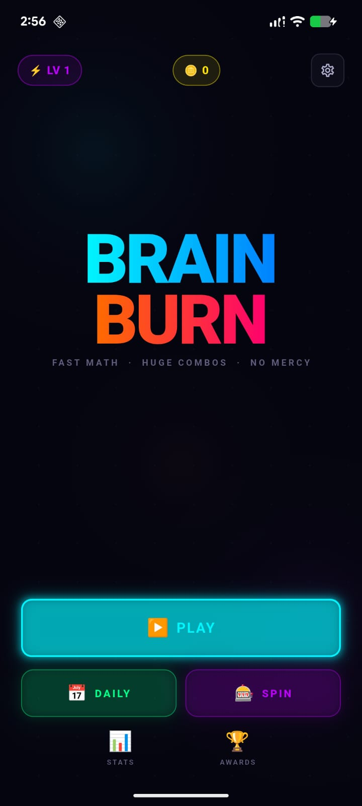
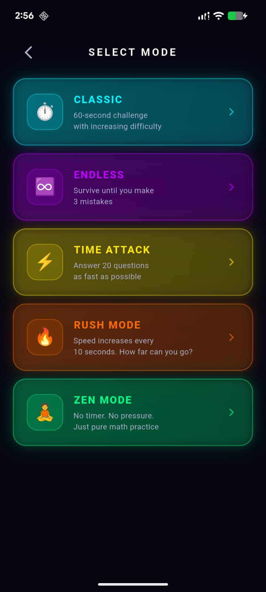
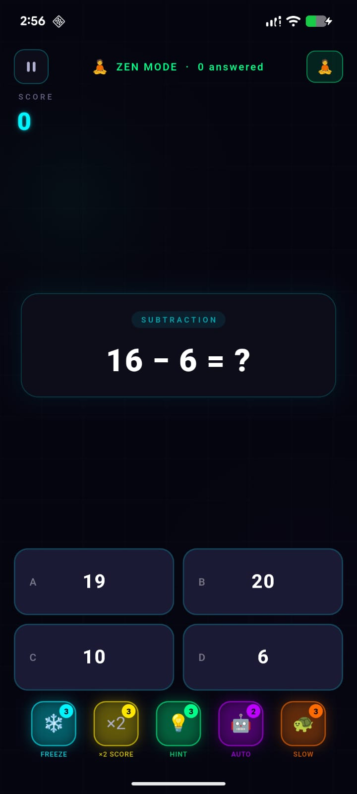
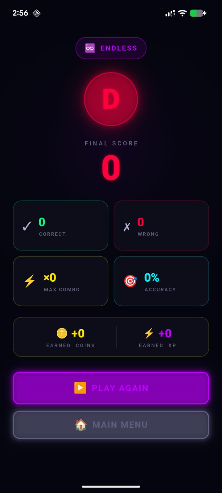
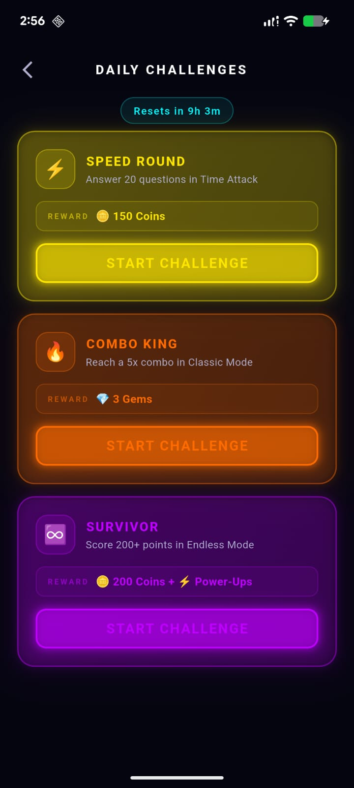
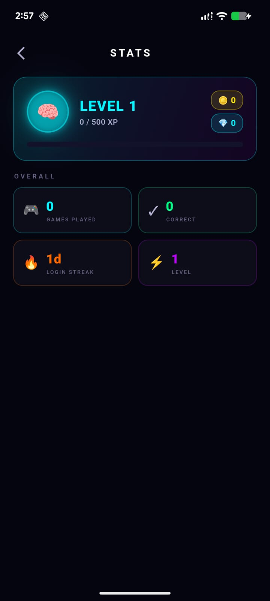

# 🧠🔥 Naci Brain

> Fast-paced neon math puzzle game — solve, combo, dominate.


---

## 📱 Screenshots

<p float="left">
  
  
  
  
  
  
</p>

---

## ✨ Features

- 🎮 **5 Game Modes** — Classic · Endless · Time Attack · Rush · Zen
- ⚡ **5 Power-Ups** — Time Freeze · Double Score · Hint · Auto Solve · Slow Motion
- 🧠 **Adaptive AI difficulty** — scales in real time with your accuracy
- 🔥 **Combo system** up to ×10 multiplier
- 🏆 **Achievements & Daily Challenges**
- 🎰 **Daily Spin wheel** for rewards
- 📊 **Persistent stats** — XP, level, coins, gems, login streak
- 🌑 **Neon animated UI** — glow effects, screen shake, dynamic backgrounds

---

## 🚀 Getting Started

```bash
git clone <url-repositori-anda>
cd Brain-Burn-main
flutter pub get
flutter run
```

---

## 🛠️ Dependencies

| Package | Use |
|---------|-----|
| `provider` | State management |
| `shared_preferences` | Local persistence |
| `flutter_animate` | Animations |
| `confetti` | Result screen celebrations |
| `google_fonts` | Typography |
| `equatable` | Model equality |

---

## 📁 Project Structure

```
lib/
├── main.dart
├── models/          — Question, GameResult, Achievement
├── providers/       — GameProvider (state management)
├── screens/         — Home, Game, Result, Stats, Achievements
├── services/        — QuestionGenerator, StorageService
├── utils/           — Constants, AppTheme
└── widgets/         — AnswerCard, ComboDisplay, PowerUpBar
```

---

## 👨‍💻 Pengembang

**Naci Brain** didirikan dan dikembangkan oleh:

**Muhammad Ikhsan**
Teknik Informatika, Universitas Pamulang
✉️ ican3192@gmail.com

---

## 🙏 Atribusi

Naci Brain dikembangkan berdasarkan proyek open source **Brain Burn** oleh
[ali-hasssan](https://github.com/ali-hasssan/Brain-Burn), yang dirilis di bawah MIT License.

---

## 📄 License

MIT License — lihat berkas [LICENSE](LICENSE). Pemberitahuan hak cipta proyek asal
tetap dipertahankan sesuai ketentuan lisensi.
